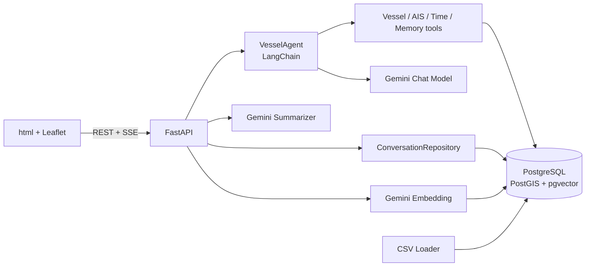
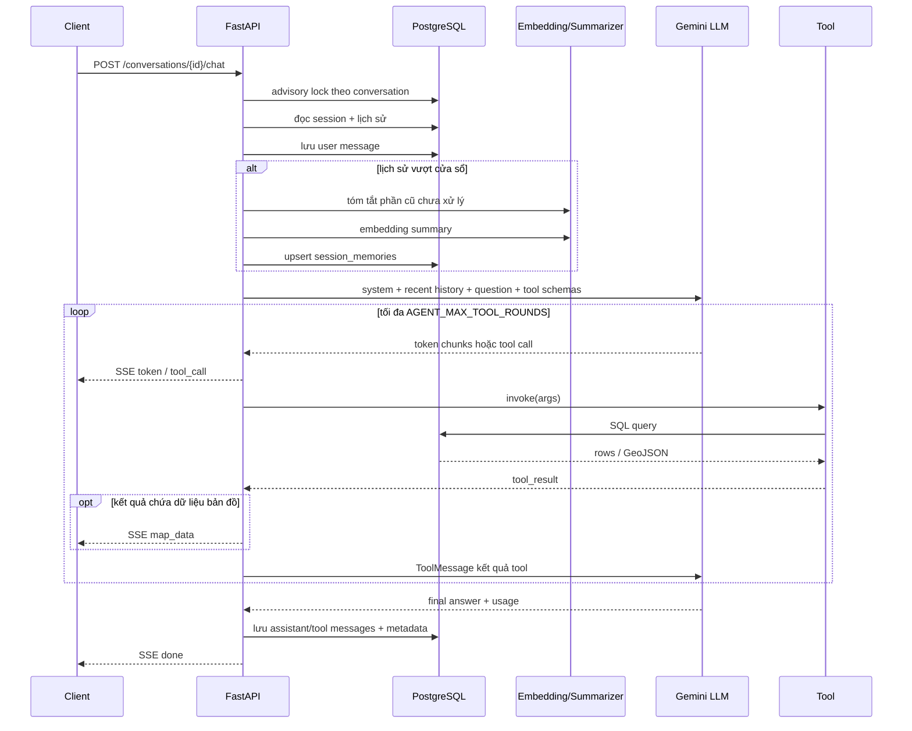
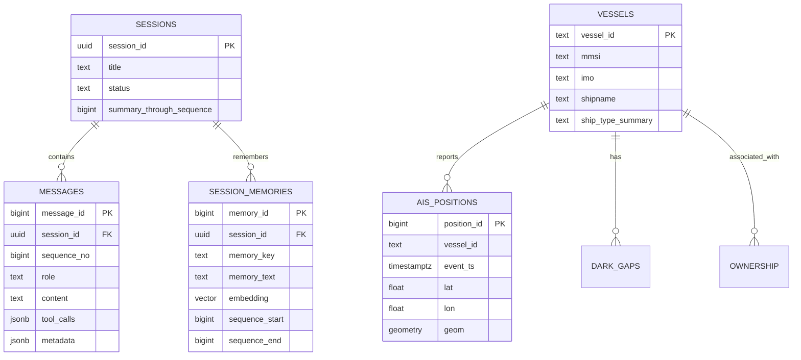

# Kiến trúc hệ thống Vessel Assistant

## 1. Tổng quan thành phần

- `src/app/main.py`: khởi tạo FastAPI, settings và services; phục vụ UI tĩnh.
- `src/app/api/conversations.py`: API hội thoại, SSE, orchestration memory và persistence.
- `src/agents/vessel_agent.py`: vòng lặp LLM/tool và phát các sự kiện agent.
- `src/agents/tools/`: tool hàng hải, AIS, thời gian và helper SQL.
- `src/app/database.py`: repository cho session, message và semantic memory.
- `src/app/sql/`: SQL được tách theo phạm vi conversation và vessel.
- `scripts/load_csv.py`: nạp dữ liệu nguồn vào PostgreSQL.

## 2. Luồng xử lý một câu hỏi

Kết quả tool được đưa lại vào LLM dưới dạng `ToolMessage` ngay sau khi tool chạy xong và trước vòng gọi model tiếp theo. Chỉ `get_vessel_route` và `get_vessels_journeys` được chuyển thành sự kiện `map_data`; các tool khác chỉ phục vụ suy luận của LLM.

Sự kiện SSE hiện có:

| Event | Dữ liệu chính | Mục đích |
| --- | --- | --- |
| `token` | `text` | Render câu trả lời từng phần |
| `tool_call` | `name`, `arguments` | Hiển thị tool đang dùng |
| `map_data` | GeoJSON và metadata | Hiển thị nút/bản đồ hành trình |
| `done` | answer, conversation, token usage | Kết thúc thành công |
| `error` | code, message, tool tùy chọn | Báo lỗi LLM, tool, summary hoặc persistence |

## 3. Thiết kế bộ nhớ hội thoại

### Bộ nhớ ngắn hạn

- Lịch sử được chia theo lượt user, không chỉ theo số row message.
- `CHAT_CONTEXT_TURNS` xác định số lượt gần nhất gửi nguyên văn.
- Tool call và tool result thuộc các lượt gần được giữ cùng ngữ cảnh cần thiết.
- Advisory lock theo `conversation_id` ngăn hai request của cùng session cập nhật sequence/memory đồng thời; session khác vẫn chạy song song.

### Bộ nhớ dài hạn

- Các message cũ ngoài cửa sổ được tóm tắt theo từng khoảng sequence chưa xử lý.
- Summary được lưu cùng embedding 768 chiều mặc định và model embedding.
- HNSW cosine index hỗ trợ tìm kiếm gần đúng.
- `search_conversation_memory` chỉ tìm trong session hiện tại và trả tối đa `MEMORY_TOP_K` kết quả đạt ngưỡng.
- `summary_through_sequence` là cursor chống tóm tắt lặp lại cùng đoạn.

### Metadata message cuối

Assistant message cuối lưu metadata phục vụ kiểm tra và khôi phục UI, gồm input/prompt liên quan, token usage và `map_data`. Các assistant message trung gian lưu `tool_calls`; tool result lưu role `tool`, tên tool và `tool_call_id`.

## 4. Schema database

Các bảng nghiệp vụ:

- `vessels`: thông số và định danh tàu; tìm tên gần đúng bằng `pg_trgm` GIN.
- `ais_positions`: điểm AIS và `geometry(Point, 4326)`; index `(vessel_id, event_ts)`, timestamp và GiST.
- `dark_gaps`: khoảng mất tín hiệu, hai điểm đầu/cuối và line geometry.
- `ownership`: quan hệ tàu–công ty theo vai trò, tên công ty chuẩn hóa.
- `sessions`: vòng đời hội thoại và cursor tóm tắt.
- `messages`: thứ tự message, role, tool call/result và metadata.
- `session_memories`: summary chunk + embedding + phạm vi sequence; unique theo `(session_id, memory_key)`.

Lưu ý: schema hiện chưa khai báo khóa ngoại từ các bảng AIS/ownership tới `vessels`, phù hợp ingest dữ liệu không hoàn chỉnh nhưng giảm bảo đảm toàn vẹn tham chiếu.

## 5. Danh sách tool

| Tool | Chức năng | Kết quả bản đồ |
| --- | --- | --- |
| `search_vessels` | Tìm tàu theo tên fuzzy, MMSI, IMO, cờ, loại tàu | Không |
| `get_vessel_details` | Thông số đăng ký theo `vessel_id` | Không |
| `get_vessel_ownership` | Chủ sở hữu/quản lý theo vai trò | Không |
| `search_vessels_by_company` | Tìm tàu liên quan một công ty | Không |
| `get_vessel_position_near_time` | Điểm AIS gần một thời điểm ISO-8601 | Không |
| `get_vessel_last_position` | Vị trí AIS mới nhất | Không |
| `get_vessel_route` | Thống kê và LineString GeoJSON trong khoảng thời gian | Có |
| `get_vessel_dark_gaps` | Liệt kê khoảng mất tín hiệu AIS | Không |
| `get_vessels_journeys` | Hành trình nhiều tàu có lọc công ty/loại tàu | Có |
| `get_current_time` | Thời gian UTC hiện tại theo ISO-8601 | Không |
| `search_conversation_memory` | Truy xuất summary cũ trong chính session | Không |

## 6. API

| Method | Endpoint | Chức năng |
| --- | --- | --- |
| `GET` | `/` | Giao diện chat |
| `GET` | `/health` | Health check |
| `POST` | `/conversations` | Tạo hội thoại, body `{ "title": string|null }` |
| `GET` | `/conversations?limit=&offset=` | Danh sách hội thoại |
| `GET` | `/conversations/{id}/messages` | Lấy toàn bộ lịch sử và metadata |
| `DELETE` | `/conversations/{id}` | Xóa session, message và memory theo cascade |
| `POST` | `/conversations/{id}/chat` | Gửi `{ "message": string }`, nhận `text/event-stream` |

FastAPI tự sinh OpenAPI tại `/docs` và `/openapi.json` khi ứng dụng chạy.

## 7. Triển khai

Docker Compose khởi động theo thứ tự: PostgreSQL khỏe → loader nạp CSV nếu bảng rỗng → API. PostgreSQL dùng volume bền vững; API lấy Gemini/model/memory settings qua environment. Source không được bind mount vào container API, do đó thay đổi code cần build lại image.
